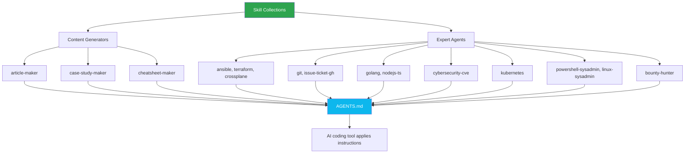

<div align="center">

  # Skill Collections
    
  <p><strong> Reusable AI agent instruction files for content generation and expert guidance.</strong></p>

<a href="#overview"></a>


</div>

## Table of Contents

- [Overview](#overview)
- [Architecture](#architecture)
- [Available Skills](#available-skills)
- [Quick Start](#quick-start)
  - [curl](#curl)
  - [PowerShell irm](#powershell-irm)
  - [wget](#wget)
  - [cp (local copy)](#cp-local-copy)
- [How It Works](#how-it-works)
- [Hosting on GitHub Pages](#hosting-on-github-pages)
- [Guidelines](#guidelines)
- [References](#references)
- [Contributing](#contributing)
- [License](#license)

---

## Overview

This repository is a practical collection of reusable agent instruction files for AI coding tools. Each `.md` file defines an agent's role, output location, formatting conventions, and style rules. Copy or download the file you need into your target project and rename it to `AGENTS.md` so the instructions are applied automatically.

## What You Will Find

- Content generators for articles, case studies, and cheatsheets
- Expert agents for infrastructure, Git, programming languages, CVE analysis, system administration, and authorized bug bounty
- A consistent per-agent format with role, scope, conventions, and output rules
- A `## AGENTS.md content (per-agent, stored here)` block inside every skill
- Files hosted on GitHub Pages so they can be fetched directly with `curl`, `irm`, or `wget`

## Architecture



## Available Skills

### Content Generators

- [article-maker](./article-maker.md)
- [case-study-maker](./case-study-maker.md)
- [cheatsheet-maker](./cheatsheet-maker.md)

### Infrastructure Experts

- [ansible-expert](./ansible-expert.md)
- [terraform-expert](./terraform-expert.md)
- [crossplane-expert](./crossplane-expert.md)
- [kubernetes-expert](./kubernetes-expert.md)

### Workflow Experts

- [git-expert](./git-expert.md) — Conventional Commits, branching, PR hygiene
- [issue-ticket-gh-expert](./issue-ticket-gh-expert.md) — create GitHub issues with `gh`

### Language Experts

- [golang-expert](./golang-expert.md)
- [nodejs-ts-expert](./nodejs-ts-expert.md)

### Security Experts

- [cybersecurity-cve-expert](./cybersecurity-cve-expert.md) — analyze CVEs and build PoCs in isolated Docker or QEMU labs
- [bounty-hunter](./bounty-hunter.md) — reads official program guides, builds `PLAN.md`, and runs scope-aware recon with native → WSL → Docker fallback

### System Administration Experts

- [powershell-sysadmin-expert](./powershell-sysadmin-expert.md) — safe, idempotent PowerShell automation and remoting
- [linux-sysadmin-expert](./linux-sysadmin-expert.md) — shell scripting, systemd hardening, and Linux operations

## Quick Start

Every method below fetches a skill file from `https://marcuwynu23.github.io/skill-collections/` and writes it as `AGENTS.md` in your target project. Examples use `ansible-expert.md`; swap in any filename from [Available Skills](#available-skills).

### curl

macOS / Linux / Git Bash / WSL:

```bash
BASE_URL="https://marcuwynu23.github.io/skill-collections"
SKILL="ansible-expert.md"

curl -fsSL "$BASE_URL/$SKILL" -o /path/to/your/project/AGENTS.md
```

One-liner from your project root:

```bash
curl -fsSL https://marcuwynu23.github.io/skill-collections/ansible-expert.md -o AGENTS.md
```

Flags: `-f` fail on HTTP errors, `-s` silent, `-S` still show errors, `-L` follow redirects, `-o <file>` write to `AGENTS.md`.

### PowerShell irm

`irm` is an alias for `Invoke-RestMethod`:

```powershell
$baseUrl = "https://marcuwynu23.github.io/skill-collections"
$skill   = "ansible-expert.md"

irm "$baseUrl/$skill" -OutFile "C:\path\to\your\project\AGENTS.md"
```

One-liner from your project root:

```powershell
irm "https://marcuwynu23.github.io/skill-collections/ansible-expert.md" -OutFile AGENTS.md
```

`iwr` / `Invoke-WebRequest` works identically:

```powershell
iwr "https://marcuwynu23.github.io/skill-collections/git-expert.md" -OutFile AGENTS.md
```

> In PowerShell, `wget` and `curl` are aliases for `Invoke-WebRequest`, so GNU-style flags do not work there — use `irm ... -OutFile`.

### wget

Classic `wget` (Linux / macOS via Homebrew / MSYS2):

```bash
BASE_URL="https://marcuwynu23.github.io/skill-collections"
SKILL="ansible-expert.md"

wget -qO /path/to/your/project/AGENTS.md "$BASE_URL/$SKILL"
```

One-liner from your project root:

```bash
wget -qO AGENTS.md https://marcuwynu23.github.io/skill-collections/ansible-expert.md
```

Flags: `-q` quiet, `-O <file>` write to `AGENTS.md`.

### cp (local copy)

After cloning this repository locally:

```bash
git clone https://github.com/marcuwynu23/skill-collections.git
cp skill-collections/ansible-expert.md /path/to/your/project/AGENTS.md
```

Or from inside this folder:

```bash
cp article-maker.md /path/to/your/project/AGENTS.md
cp git-expert.md     /path/to/your/project/AGENTS.md
```

> Any of these methods overwrites an existing `AGENTS.md` in the destination. Back it up first if you need to keep it.

## How It Works

1. Each skill file contains a role, output path, required sections, and style rules.
2. Fetching or copying it into `AGENTS.md` makes those instructions active in the destination project.
3. The agent then generates content or follows the conventions exactly as described in the file.
4. To switch skills, simply replace `AGENTS.md` with a different file.


## Guidelines

### Best Practices

1. **Pick one skill per `AGENTS.md`** — replace the file to switch agents; do not merge multiple skill files.
2. **Back up existing instructions** before overwriting `AGENTS.md`.
3. **Let the agent inspect the environment first** — every expert checks installed tool versions and platform before making changes.
4. **Expect troubleshooting guidance** — every expert includes version-aware diagnostic commands and fix tables.
5. **Let the agent run its verification loop** — every skill plans, executes, verifies, corrects, and reports what remains unverified.
6. **Use an absolute output path** in `curl`/`irm`/`wget` commands, or run from the project root.
7. **Keep the source files unchanged** — customize the copied `AGENTS.md` in your project instead.
8. **Verify the download** after fetching:
   ```bash
   head -n 5 AGENTS.md
   ```

### Troubleshooting

| Problem | Solution |
|---|---|
| `404` from `curl`/`irm`/`wget` | Check the URL, filename, and that Pages is enabled |
| HTML returned instead of markdown | Add `.nojekyll` at the repo root and wait for the Pages rebuild |
| `curl: command not found` | Use PowerShell `irm`, `wget`, or install curl |
| PowerShell `wget` flags fail | It is an `Invoke-WebRequest` alias — use `irm ... -OutFile` |
| `AGENTS.md` not applied | Ensure the file is at the project root with the exact name |

### Useful Commands

```bash
curl -fsSL "$BASE_URL/$SKILL" -o AGENTS.md              # curl
irm "$baseUrl/$skill" -OutFile AGENTS.md                 # PowerShell
wget -qO AGENTS.md "$BASE_URL/$SKILL"                    # wget
cp article-maker.md /path/to/your/project/AGENTS.md      # local copy
head -n 5 AGENTS.md                                      # verify
```

## References

- [GitHub Pages Documentation](https://docs.github.com/en/pages)
- [curl Documentation](https://curl.se/docs/)
- [GNU wget Manual](https://www.gnu.org/software/wget/manual/)
- [PowerShell Invoke-RestMethod](https://learn.microsoft.com/en-us/powershell/module/microsoft.powershell.utility/invoke-restmethod)

## Contributing

Contributions are welcome. To add or improve a skill, open a pull request with a short description of the agent's role, scope, and conventions, and include an example of its expected output.

## License

This project is licensed under the MIT License.
