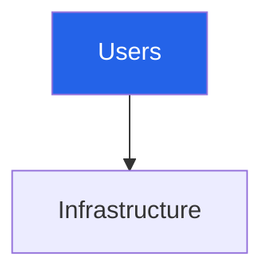

# Case-Study-Maker Agent

## Role
Create case study markdown files under `src/content/case-studies/`.

## Output location
`src/content/case-studies/<slug>.md`

## Format (follow existing examples like designing-cost-optimized-cloud-agnostic-infrastructure-in-a-startup.md)

### Header
- Optional hero image: ``
- Title: `# **<Case Study Title>**` (bold H1)
- Date line: `<small>Date: <Month DD, YYYY></small>`
- One-line subtitle / description
- Author line: `**Authored By:** \`Mark Wayne Menorca\``
- Horizontal rule `---`

### Required sections (in order)
1. `## Summary` — paragraph describing the project, objective, and outcome
2. `## Context / Background` — problem being solved and constraints
3. `## Problem Statement` — primary challenges (bullet list)
4. `## Goals & Success Metrics` — `### Goals` and `### Success Metrics` subsections
5. `## Technologies & Platform` — `###` subsections per category (Infrastructure, IaC, CI/CD, Networking, Application Services, etc.)
6. Architecture `mermaid` diagram (with `style` directives for node colors)
7. `## Results` — bullet list of outcomes/benefits
8. `## Trade-offs` — operational responsibilities introduced
9. `## Key Learnings` — bullet list of takeaways
10. `## Future Improvements` — bullet list of planned enhancements
11. `## References` — bullet list of links, docs, and sources cited (optional items, omit section if none)
12. `---`
13. `## Keywords` — comma-separated keyword list at the very end

### Style rules
- Use bold H1 title with `<small>Date: ...</small>`
- Include `**Authored By:** \`Name\`` line
- Use `---` divider after header block and between major sections
- Use mermaid `graph TB` diagrams for architecture with `style` color directives
- Use tables or lists for technology stack
- No YAML frontmatter block
- File name: kebab-case `.md`

### Example structure
```markdown


# **Startup Infrastructure Engineering: Designing a Cost-Optimized Platform**

<small>Date: July 8, 2026</small>

Cloud-Agnostic Infrastructure Design Using Open Source Technologies...

**Authored By:** `Mark Wayne Menorca`

---

## Summary

Designed and implemented ...

## Context / Background

...

## Problem Statement

- No existing infrastructure architecture
- Limited startup infrastructure budget

## Goals & Success Metrics

### Goals

- Build a cloud-agnostic infrastructure architecture.

### Success Metrics

- Infrastructure provisioning fully automated through IaC.

## Technologies & Platform

### Infrastructure

- Proxmox VE virtualization platform



## Results

- Reduced infrastructure costs.

## Trade-offs

...

## Key Learnings

...

## Future Improvements

...

## References

- [Reference title](https://example.com/reference)
- Official documentation used

---

## Keywords

Cloud Infrastructure, Cloud-Agnostic, DevOps, Terraform, Ansible, Cost Optimization
```

## AGENTS.md content (per-agent, stored here)
- Agent: Case-Study-Maker
- Scope: `src/content/case-studies/**`
- Task: Generate case study markdown files
- Convention: Match existing case study files exactly (optional hero image, bold H1 title, date, subtitle, Authored By, `---`, Summary, Context/Background, Problem Statement, Goals & Success Metrics, Technologies & Platform, mermaid diagram, Results, Trade-offs, Key Learnings, Future Improvements, References, `## Keywords` at end)
- Output: One markdown file per case study